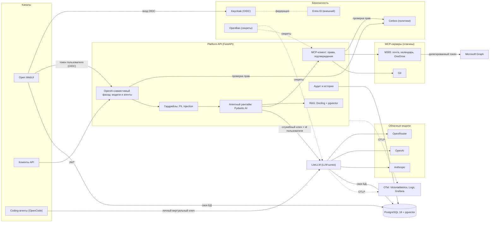

# Архитектура v1

Статус: черновик для MVP. Обновлено: 2026-11-22.
Решения: [ADR-0001](../adr/0001-llm-gateway-litellm.md), [ADR-0002](../adr/0002-chat-ui-open-webui.md),
[ADR-0003](../adr/0003-postgresql-single-datastore.md), [ADR-0004](../adr/0004-dependency-pinning-and-supply-chain.md),
[ADR-0005](../adr/0005-core-and-instance-repositories.md), [ADR-0006](../adr/0006-platform-api-data-model.md), [ADR-0009](../adr/0009-authorization-cerbos.md), [ADR-0008](../adr/0008-plugin-contract-and-instance-template.md), [ADR-0010](../adr/0010-agent-runtime.md).

## Главная идея

Внешние компоненты (UI, LLM-шлюз, IdP) не хранят ничего, что нельзя потерять при их замене.
Всё ценное (история, аудит, права, бюджеты, конфигурация агентов) принадлежит **Platform API**
и лежит в нашем PostgreSQL. Open WebUI и LiteLLM подключены через OpenAI-совместимый API
и заменяются сменой адреса и адаптера, без миграции данных.

Документ описывает ядро и стандартный профиль инсталляции. Конкретная инсталляция (Mtech, клиент)
выбирает компоненты в своём репозитории (ADR-0005): например, адаптер Teams вместо Open WebUI.
Контракт инсталляции (ADR-0008): манифест `instance.yaml` (модели, MCP-серверы, настройки),
политики Cerbos в scope инсталляции, плагины только вне процесса Platform API.

## Компоненты v1

| Часть | Компонент | Роль | Граница (как заменить) |
| --- | --- | --- | --- |
| Вход | Reverse proxy (Caddy или Traefik, выбрать в PoC) | TLS, единая точка входа | HTTP |
| Безопасность | Keycloak | OIDC-провайдер, федерация с Entra ID, token exchange | OIDC/OAuth2 |
| Безопасность | Cerbos | Политики: кто может вызывать какой агент, инструмент, модель | `PolicyClient` по AuthZEN |
| Безопасность | OpenBao | Ключи провайдеров, секреты коннекторов | `SecretProvider`, Vault API |
| Каналы | Open WebUI | Веб-чат, тонкий клиент | OpenAI-совместимый API к Platform API |
| Каналы | OpenCode и др. coding-агенты | Работа разработчиков | OpenAI-совместимый API к LiteLLM, личный виртуальный ключ |
| Ядро | Platform API (свой, FastAPI) | OpenAI-совместимый фасад (модели и агенты), история чатов, агентный рантайм, RAG, MCP-клиент, гардрейлы, аудит, управление ключами и бюджетами | Наш код |
| Ядро | Pydantic AI | Агенты (ADR-0010); ожидание подтверждений в `agent_runs` Platform API, DBOS отложен | `AgentRuntime`; `WorkflowEngine` позже |
| Ядро | Docling + pgvector | Парсинг и векторный поиск для RAG | `DocumentParser`, `Retriever` |
| Модели | LiteLLM | LLM-шлюз: маршрутизация, виртуальные ключи, бюджеты, учёт расходов | OpenAI-совместимый API + `GatewayAdmin` |
| Модели | OpenRouter, OpenAI, Anthropic | Облачные модели | Через LiteLLM, логические имена моделей |
| Инструменты | MCP-серверы M365 (почта, календарь, OneDrive) и Git | Плагины-инструменты | MCP |
| Данные | PostgreSQL 18 + pgvector | Все прикладные данные, отдельная БД и роль на сервис | SQL |
| Наблюдаемость | OTel Collector + VictoriaMetrics/Logs + Grafana | Метрики, логи, трейсы, алерты | OTLP |

В v1 **нет**: отдельного MCP-шлюза (его роль выполняет MCP-клиент Platform API), локальных моделей
(v2), MongoDB, Redis, Langfuse, Telegram и Slack (пилот).

## Схема

## Путь запроса из веб-чата

1. Пользователь входит в Open WebUI через Keycloak (федерация с Entra ID).
2. Open WebUI отправляет запрос в OpenAI-совместимый фасад Platform API с access token
   пользователя из Keycloak (`auth_type: system_oauth`, ADR-0006). Platform API проверяет подпись,
   `iss`, `aud` = `platform-api` и клиента (`azp`). Прямые подключения из Open WebUI к провайдерам
   и к LiteLLM отключены.
3. Platform API сопоставляет пользователя по `(iss, sub)` токена Keycloak (плюс `idp`, `entra_oid`,
   ADR-0007) и спрашивает Cerbos, доступна ли ему выбранная модель или агент.
4. Входные гардрейлы: маскирование PII, проверка на prompt injection.
5. Обычный чат: запрос уходит в LiteLLM служебным ключом Platform API с идентификатором
   пользователя для учёта расходов и бюджета. Агент: рантайм выполняет шаги, ищет в RAG,
   вызывает инструменты.
6. Вызов инструмента: проверка прав в Cerbos, затем MCP-сервер с правами пользователя: Platform API
   обменивает токен пользователя на токен с аудиторией этого MCP-сервера (token exchange V2, ADR-0007).
   Отправка письма, создание события, запись в Git ждут подтверждения человеком (состояние в
   `agent_runs` Platform API, ADR-0010).
7. Выходные гардрейлы, ответ в UI. История, аудит и расходы записываются в PostgreSQL Platform API.

Coding-агенты ходят в LiteLLM напрямую с личным виртуальным ключом, который выпускает Platform API
(бюджет, разрешённые модели, отзыв при увольнении).

## Границы замены

| Граница | Контракт | v1 | Замена |
| --- | --- | --- | --- |
| UI ↔ платформа | OpenAI-совместимый API Platform API + OIDC | Open WebUI | LibreChat, свой UI |
| Платформа ↔ LLM-шлюз | OpenAI-совместимый API; логические имена моделей (`chat-default`, `code-strong`) | LiteLLM | Bifrost, agentgateway |
| Управление ключами и бюджетами | Адаптер `GatewayAdmin`: create_key, revoke_key, set_budget, get_spend | LiteLLM management API | Адаптер под новый шлюз |
| Учёт расходов | Колбэк шлюза → таблица расходов Platform API | LiteLLM callback / OTel | Любой шлюз с OTel |
| Аутентификация | OIDC/OAuth2, token exchange | Keycloak | Authentik, другой IdP |
| Политики | `PolicyClient.check(subject, action, resource)`, AuthZEN | Cerbos | OPA, OpenFGA |
| Инструменты | MCP | Свои MCP-серверы | Любой MCP-сервер |
| Агенты | `AgentRuntime`, агент в манифесте (ADR-0010) | Pydantic AI | LangGraph |
| Процессы | `WorkflowEngine` (позже) | своя таблица `agent_runs` | DBOS, Temporal |
| Секреты | `SecretProvider` | OpenBao | Infisical, Vault |
| Данные | SQL, отдельная БД на сервис | PostgreSQL 18 | Managed PostgreSQL |
| Телеметрия | OTLP, семантика GenAI | VictoriaStack + Grafana | Любой OTLP-бэкенд |

Правило: наш код не импортирует SDK LiteLLM, Open WebUI или других вендоров вне `adapters/`.
Будет проверяться в CI (import-linter), задача в бэклоге.

## Изменения относительно первого предложения (21.11.2026)

- Чат-UI: Open WebUI вместо LibreChat (решение CTO; MongoDB больше не нужна).
- LLM-шлюз: LiteLLM вместо agentgateway, с жёстким закреплением версий (ADR-0001, ADR-0004).
- MCP-шлюз в v1 не выделяется: MCP-клиент в Platform API.
- Локальные модели и Ollama перенесены в v2.
- Расчётный размер организации: 500 пользователей.
- Исходный обзор кандидатов: [research/2026-11-21-component-scan.md](../research/2026-11-21-component-scan.md).
